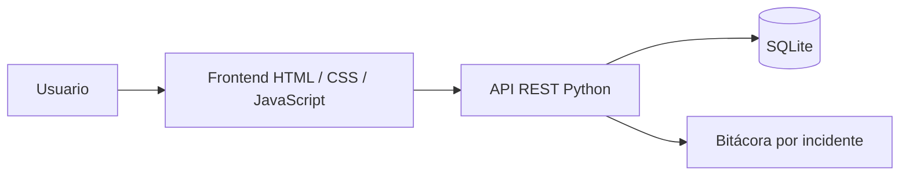

# Arquitectura

Una conexión SQLite por operación, transacciones con rollback automático y cierre explícito. Las consultas emplean parámetros; los nombres de columnas de filtros proceden de una lista fija. La base queda fuera del directorio público. Fechas UTC ISO 8601, presentadas en la zona del navegador.

## API

| Método | Ruta | Resultado |
|---|---|---|
| GET | /api/health | Estado y versión |
| GET | /api/meta | Catálogos y transiciones |
| POST | /api/incidents | Crear; retorna 201 |
| GET | /api/incidents | Lista; admite status, priority, category, technician |
| GET | /api/incidents/{id} | Detalle e historial |
| PATCH | /api/incidents/{id} | actor, technician, status |
| POST | /api/incidents/{id}/comments | actor y message |
| GET | /api/dashboard | Contadores y distribuciones |

Creación: `title`, `description`, `category`, `priority`, `user`. Categorías: Hardware, Software, Red, Accesos, Otros. Prioridades: BAJA, MEDIA, ALTA, CRITICA. JSON inválido produce 400; recurso inexistente 404; cuerpo excesivo 413; tipo de contenido incorrecto 415; fallo de base 503.

Las escrituras de operación y bitácora se confirman juntas. Una transición inválida no modifica datos. La lista limita a los 500 incidentes más recientes; los indicadores consideran toda la base. Paginación pendiente.
